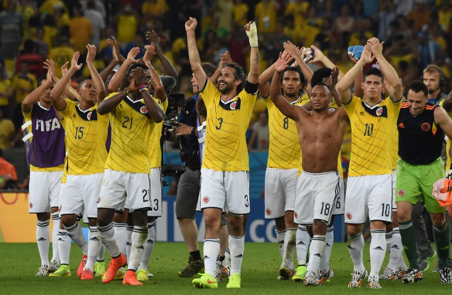
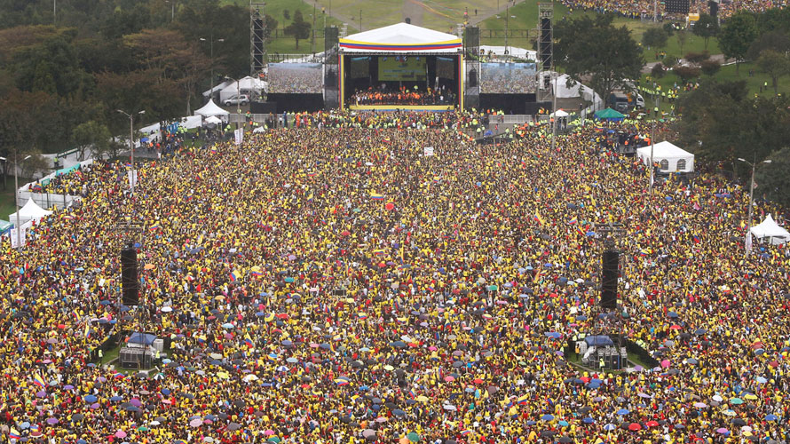

# De grupo a equipo

> Archivo generado por `scripts/exportar_contenido.py` a partir de `clase.json` y `slides/`. No lo edites a mano.

- **Clase:** 002
- **Fecha:** 2026-10-01
- **Pilar:** Conexión
- **Estado:** presentacion

## Ficha

- **Tesis:** Un equipo de verdad está conectado por una brújula que declaró junto: propósito, identidad, visión y metas.
- **Transformación:** de un grupo de personas responsables cada una por su lado a un equipo conectado por una brújula que declaró junto: propósito, identidad, visión y metas.
- **Quiebre:** Si le preguntara hoy a cada persona de tu equipo para qué existe el equipo, ¿darían la misma respuesta?
- **Ejercicio:** El equipo que declaramos: en dos columnas, tres palabras sobre lo que un observador vería hoy en el equipo y tres sobre lo que vería dentro de un año si fuera el equipo que el líder quiere; comparar la distancia y reconocer qué parte depende del líder. El borrador completo de la brújula se construye después con el equipo, usando las 4 preguntas.
- **Compromiso:** Elegir una de las 4 preguntas (¿Para qué existimos? ¿Cómo somos? ¿Qué nos identifica? ¿Hacia dónde vamos?) y hacérsela a tu equipo esta semana, con día definido. Tú facilitas; la respuesta es del equipo.
- **Bucle abierto:** Declarar quiénes somos toma una tarde. Vivirlo toma todos los días. ¿Cómo se sostiene una identidad cuando llega la presión?
- **Frase ancla:** Solos corremos más rápido, pero juntos llegamos más lejos.

**Temas:** Grupo y equipo · Responsabilidad mutua · La brújula del equipo: propósito, identidad, visión y metas · Propósito · Identidad: valores, principios, símbolos y frase que nos define · Visión y metas · Errores comunes del líder en cada elemento · Declarar con el equipo en lugar de imponer · Las 4 preguntas para tu equipo · El líder como facilitador

**Herramientas:** Brújula del equipo · Las 4 preguntas para tu equipo · Los 3 pasos del líder facilitador · Ejercicio El equipo que declaramos

### Distinciones

| Término | Definición |
|---|---|
| Equipo | Grupo de personas comprometidas con un propósito común y metas compartidas, de las que se hacen mutuamente responsables. |
| Responsabilidad mutua | Hacerse cargo no solo de mis promesas sino del resultado que prometimos juntos. |
| Declaración | Acto del lenguaje que crea una realidad nueva. Requiere autoridad y compromiso. |
| Propósito | Declaración de para qué existe el equipo y a quién sirve. |
| Identidad | Quiénes somos y cómo somos: valores, principios, símbolos y una frase que nos define. |
| Valores | Lo que el equipo declara que le importa. |
| Principios | Conductas no negociables que hacen visible un valor. |
| Símbolos | Lo que hace visible la identidad y crea pertenencia: un nombre, un lema, un ritual. |
| Visión | Declaración del futuro que el equipo quiere crear. |
| Metas | Promesas medibles que indican si el equipo avanza hacia su visión. |
| Identidad pública | Los juicios que otros hacen de nosotros a partir de lo que hacemos. |
| Brújula del equipo | Los 4 elementos que un equipo declara junto y que lo conectan: propósito, identidad, visión y metas. |

### Fuentes

- Rafael Echeverría, Ontología del lenguaje
- Jon Katzenbach y Douglas Smith, The Wisdom of Teams (1993)
- José Pékerman, frase en video (recursos/pekerman.mp4)
- Selección Colombia, Mundial 2014 (ejemplo)

## Diapositivas

### 1. De grupo a equipo

- *Ilustración: Puntos sueltos que se unen en una red*
- Lo que convierte un grupo en equipo

> **Notas del orador:** APERTURA · 0:00. Bienvenida. Pide papel y lápiz desde ya: los van a necesitar al final. Hoy empezamos el pilar de Conexión: de lo que yo hago a lo que hacemos juntos.

### 2. Los 3 pilares del liderazgo personal

- **Responsabilidad personal**: Hacerme cargo de lo que depende de mí y de cómo respondo a lo que pasa.
- **Conexión** (pilar de hoy): Construir confianza y conversaciones que acercan al equipo.
- **Integración**: Llevar lo declarado a la práctica diaria y sostenerlo en el tiempo.

### 3. Lo que aprendimos la clase anterior

*De la víctima a la responsabilidad*

1. La víctima y la responsabilidad son dos formas de observar, no dos tipos de personas.
2. Separar hechos de interpretaciones abre posibilidades que el juicio cierra.
3. Antes de cambiar la conversación del otro, el líder cambia el lugar desde donde mira.

> “Un gran líder acompaña al otro a verse en su absoluta grandeza y posibilidad.”

### 4. ¿Cumpliste tu compromiso?

- Tener esta semana la conversación que rediseñaste con una persona de tu equipo, con nombre y día definidos.

### 5. Si le preguntara hoy a cada persona de tu equipo para qué existe el equipo, ¿darían la misma respuesta?

- *Ilustración: Varias respuestas distintas a la misma pregunta*
- Para vender más · Para cumplir metas · Para atender clientes · No sé

> **Notas del orador:** QUIEBRE · 0:05 – 0:08. Cascada en el chat: escriben sí, no o no sé, y envían todos al mismo tiempo cuando lo indiques. Lee el patrón en voz alta: casi siempre predominan el no y el no sé. Nómbralo sin dramatizar.

### 6. Un grupo comparte un jefe. Un equipo comparte un para qué.

> **Notas del orador:** QUIEBRE · cierre. Pausa. Deja que la frase se asiente antes de pasar.

### 7. ¿Cómo hago que mi equipo sea un equipo de verdad?

- *Ilustración: Brújula del equipo: propósito, identidad, visión y metas*
- Con cuatro elementos que declaran juntos y que los conectan.

> **Notas del orador:** LA GRAN IDEA · 0:08 – 0:10. Esta es la pregunta de toda la clase; vuelve a ella al final de cada bloque. Puente con la 001: la responsabilidad personal es la materia prima, pero si cada uno rema para su lado no hay equipo. Eso es Conexión. Tesis: un grupo se convierte en equipo cuando declara junto su brújula: propósito, identidad, visión y metas. La brújula aparecerá en cada bloque.

## P.01 · Qué conecta a un equipo de verdad

> **Notas del orador:** COMPRENDER · 0:10 – 0:24. El centro de la clase: la brújula del equipo, un elemento a la vez, con la Selección Colombia 2014 como ejemplo.

### 9. Grupo o equipo

- *Ilustración: Puntos sueltos*
- **Grupo**
- “Yo ya hice mi parte.”
- “Eso no es mi área.”
- “Que lo decida el jefe.”
- *Ilustración: Puntos unidos en una red*
- **Equipo**
- “¿Cómo vamos con lo nuestro?”
- “¿En qué te ayudo para que lleguemos?”
- “Si a ti te va mal, nos va mal.”
- Equipo: personas comprometidas con un propósito común, de las que se hacen mutuamente responsables · Katzenbach y Smith, The Wisdom of Teams (1993)

> **Notas del orador:** COMPRENDER · 2 min. Lee las frases del grupo con el tono con que se dicen en la oficina, luego las del equipo. Lo que distingue a un equipo de verdad es la responsabilidad mutua: de "me hago cargo de lo mío" (la 001) a "nos hacemos cargo de lo nuestro". AQUÍ VA TU HISTORIA de un grupo que se volvió equipo, solo hablada. Puente: "Miremos un equipo que todos conocemos."

### 10. Selección Colombia · Mundial 2014

- 

> **Notas del orador:** COMPRENDER · 30 s. Deja la foto en silencio unos segundos. Pregunta: ¿qué recuerdan de ese Mundial? Deja que dos o tres respondan en voz o en el chat.

### 11. Talento había de sobra. ¿Qué los convirtió en equipo?

- *Ilustración: Cancha de fútbol con once jugadores conectados*
- **Cuartos de final**
- Su mejor resultado en un Mundial.
- **Goleador del torneo**
- James Rodríguez, con seis goles.
- **El baile**
- Cada gol se celebraba juntos.

> **Notas del orador:** COMPRENDER · 1 min. Datos verificables: cuartos de final (su mejor resultado en un Mundial), James Rodríguez goleador del torneo con 6 goles, las celebraciones con baile grupal. Equipos con más estrellas se quedaron antes. Pregunta abierta: ¿qué los conectaba? Puente: "Lo que los conectaba se puede leer con una brújula de cuatro puntos."

### 12. La brújula de un equipo de verdad

- *Ilustración: Brújula del equipo: propósito, identidad, visión y metas*
- **Propósito**
- ¿Para qué existimos y a quién servimos?
- **Identidad**
- ¿Quiénes somos y cómo somos?
- **Visión**
- ¿Hacia dónde vamos?
- **Metas**
- ¿Cómo sabremos que avanzamos?

> **Notas del orador:** COMPRENDER · 1 min. El modelo de la clase: cuatro elementos que un equipo declara junto. No los expliques aquí: vamos a recorrerlos uno por uno con la Selección. Visión y metas van juntas: la visión es el destino; las metas, las marcas del camino.

### 13. Propósito

- *Ilustración: Brújula del equipo: propósito, identidad, visión y metas*
- ¿Para qué existimos y a quién servimos?
- **En la Selección**
- Representar a un país y darle una alegría.
- **En tu equipo**
- Existimos para que cada cliente tome una buena decisión de compra.
- 

> **Notas del orador:** COMPRENDER · 2 min. El propósito responde para qué existimos y a quién servimos. La Selección no jugaba solo para ganar: jugaba por un país. Es una lectura desde este modelo, no una declaración oficial. La foto muestra a quién servía la Selección: a un país entero vestido de amarillo. Pregunta: si tu equipo desapareciera mañana, ¿quién lo notaría?

### 14. Identidad

- *Ilustración: Brújula del equipo: propósito, identidad, visión y metas*
- ¿Quiénes somos y cómo somos?
- **Valores**
- Cómo somos. Lo que nos importa.
- Alegres.
- Disfrutamos lo que hacemos.
- Unidos.
- **Principios**
- Cómo actuamos, siempre. El valor hecho conducta.
- Cada gol se celebra juntos.
- Nadie juega para sí mismo.
- En tu equipo: el respeto por el tiempo del otro → empezamos a la hora, estén todos o no.

> **Notas del orador:** COMPRENDER · 2 min. La identidad responde quiénes somos y cómo somos. Los valores dicen cómo somos (la Selección: alegres, disfrutamos, unidos). Los principios son las conductas no negociables que hacen visible el valor. Un valor sin principio es un cartel en la pared. Pregunta: ¿qué valor de tu equipo todavía no tiene su conducta?

### 15. “Solos corremos más rápido, pero juntos llegamos más lejos.”

- Video: [pekerman.mp4](recursos/pekerman.mp4)
- José Pékerman, técnico de la Selección

> **Notas del orador:** COMPRENDER · identidad · VIDEO 1:27 · 2 min. Haz clic en el video para reproducirlo (el clic sobre el video no avanza la diapositiva; la barra espaciadora pausa). En Zoom, al compartir pantalla, activa "Compartir sonido" y "Optimizar para videoclip". Después: una frase que define a un equipo también es parte de su identidad; resume cómo somos en una línea que todos pueden repetir. Pregunta: ¿qué frase definiría a tu equipo?

### 16. Lo que nos identifica

- **El himno**
- Nos pone de pie a todos al mismo tiempo.
- **La camiseta amarilla**
- Nos reconocen en cualquier lugar del mundo.
- **El baile**
- Así celebramos: juntos.
- En tu equipo: un nombre, un lema, un ritual para empezar la semana.
- 

> **Notas del orador:** COMPRENDER · identidad · 2 min. Los símbolos hacen visible la identidad y crean pertenencia: el himno, la camiseta, el baile. Nadie los impuso uno por uno; se volvieron nuestros porque los vivimos juntos. Pregunta: ¿qué símbolo tiene tu equipo? Si no tiene ninguno, ¿cuál podría nacer de ustedes?

### 17. Visión y metas

- *Ilustración: Brújula del equipo: propósito, identidad, visión y metas*
- ¿Hacia dónde vamos y cómo sabremos que avanzamos?
- *Ilustración: Camino con tres metas que llevan a la visión*
- 1 · Fase de grupos · 2 · Octavos · 3 · Cuartos · Más lejos que nunca
- **Visión en la Selección**
- Llegar más lejos que nunca en un Mundial.
- **En tu equipo**
- Ser el equipo al que las otras áreas quieren pedirle ayuda. Meta: resolver cada solicitud el mismo día.

> **Notas del orador:** COMPRENDER · 2 min. La visión es el destino: el futuro que el equipo quiere crear. Las metas son las marcas del camino: cómo sabremos que avanzamos. La Selección no pensaba en la copa desde el primer día: primero la fase de grupos, después octavos, después cuartos. Pregunta: ¿las metas de tu equipo apuntan a una visión, o solo a cumplir el mes? Puente al bloque 2: "Ya tienes la brújula. ¿Tu equipo la tiene? ¿Y quién la definió?" Cierre de Comprender en el minuto 24.

## P.02 · El observador del líder

> **Notas del orador:** CONSTRUIR · 0:24 – 0:29. El líder se mira a sí mismo frente a la brújula. No aceleres aquí.

### 19. ¿Quién definió el propósito y los valores de tu equipo?

- **A · Yo solo**
- **B · La empresa o Recursos Humanos**
- **C · El equipo conmigo**
- **D · Nadie: no los tenemos**

> **Notas del orador:** CONSTRUIR · ENCUESTA DE ZOOM · 1,5 min. Lánzala con estas cuatro opciones y comparte los resultados en pantalla. Léelos sin juicio. Pregunta en voz alta: si los escribiste tú solo o los escribió la empresa, ¿de quién son?

### 20. Errores comunes del líder

- Propósito
- **“Aquí todos sabemos para qué estamos.”**
- Lo supone; nunca lo declararon juntos.
- Identidad
- **“Los valores ya están en la pared.”**
- Confunde el cartel con la conducta.
- Identidad
- **“Las reglas son para el equipo.”**
- Rompe la identidad desde arriba.
- Visión
- **“Mi visión para este equipo es…”**
- Es la visión del jefe, no la del equipo.
- Visión
- **“Primero cumplamos el mes, después soñamos.”**
- Sin visión, solo queda sobrevivir.
- Metas
- **“La meta es la que nos pusieron.”**
- Una meta sin propósito no conecta.
- Todos
- **“Yo defino y ustedes ejecutan.”**
- Impone en lugar de declarar juntos.

> **Notas del orador:** CONSTRUIR · 2,5 min. Cada error rompe un punto de la brújula. Lee las frases despacio y pide que marquen en su papel las que han dicho o pensado. Detente en la última: rompe todos a la vez. AQUÍ VA TU HISTORIA del equipo con valores en la pared que no se vivían, solo hablada.

### 21. ¿Declaras la identidad de tu equipo o la impones?

- No se describe ni se impone: se declara juntos.

> **Notas del orador:** CONSTRUIR · cierre · 1 min. Distinción ontológica (Echeverría): una afirmación describe lo que ya existe; una declaración crea algo nuevo y requiere autoridad y compromiso. Lo que un equipo es se declara, y la autoridad para hacerlo es del equipo completo: si lo escribe solo el líder, es un cartel. Si te preguntan: la identidad pública (Echeverría) son los juicios que otros hacen de nosotros por lo que hacemos. Silencio de 5 segundos. Puente: "Entonces, ¿cómo lo declaro con mi equipo?" Cierre de Construir en el minuto 29.

## P.03 · Cómo declararla con tu equipo

> **Notas del orador:** EMERGER · 0:29 – 0:35. La respuesta a la pregunta de la clase: la conversación con la que el equipo declara su brújula.

### 23. Las 4 preguntas para tu equipo

- *Ilustración: Brújula del equipo: propósito, identidad, visión y metas*
- 1 · Propósito
- **¿Para qué existimos?**
- ¿A quién servimos?
- 2 · Identidad
- **¿Cómo somos?**
- ¿Qué haríamos siempre, aunque cueste?
- 3 · Símbolos
- **¿Qué nos identifica?**
- ¿Qué frase nos define?
- 4 · Visión y metas
- **¿Hacia dónde vamos?**
- ¿Cómo sabremos que avanzamos?

> **Notas del orador:** EMERGER · 3 min. La herramienta de la clase. Cada elemento tiene una pregunta corta, fácil de recordar, y una de seguimiento para profundizar. Van en este orden porque cada una se apoya en la anterior. En identidad, empuja siempre de valor a conducta: "¿Qué haríamos siempre, aunque cueste?"

### 24. El líder facilita, no dicta

- **1 · Pregunta y escucha**
- No llegas con la respuesta escrita. La respuesta es del equipo.
- **2 · De valores a conductas**
- “Respeto” se vuelve “empezamos a la hora”.
- **3 · Elijan sus símbolos y su frase**
- Un nombre, un ritual, una frase que todos puedan repetir.

> **Notas del orador:** EMERGER · 3 min. Cómo conduces la conversación de las 4 preguntas. Paso 1: si llegas con la respuesta, el equipo la recibe, no la declara. Paso 2: una conducta se puede observar; un valor abstracto, no. Paso 3: los símbolos y la frase crean pertenencia, como el himno, la camiseta y el baile de la Selección. Puente: "Hagámoslo ahora con tu equipo, en papel." Cierre de Emerger en el minuto 35.

## P.04 · El equipo que declaramos

> **Notas del orador:** PRÁCTICA · 0:35 – 0:45. Individual, en papel, en dos columnas: hoy y en un año. Da cada fase de forma verbal y con el tiempo en voz alta. Hoy 3 min, en un año 3 min, brecha 3 min, cosecha 1 min.

### 26. Piensa en tu equipo tal como es hoy.

- *Ilustración: Binoculares*
- Si alguien observara a tu equipo una semana sin escuchar lo que dicen, ¿qué diría que les importa?
- Escribe tres palabras en una columna: Hoy.

> **Notas del orador:** PRÁCTICA · 1 DE 4 · 3 MIN. La identidad vivida. Guía: "No lo que dicen en las reuniones: lo que se ve en cómo trabajan, qué se premia, qué se tolera, a qué le dedican el tiempo". Silencio.

### 27. Ahora imagina a tu equipo dentro de un año, como quisieras que fuera.

- **Hoy**
- **En un año**
- ¿Qué tres palabras diría ese mismo observador?
- Escríbelas al lado de las primeras.

> **Notas del orador:** PRÁCTICA · 2 DE 4 · 3 MIN. El equipo que quieres. Misma pregunta, mismo observador, mismo formato: tres palabras. Así la comparación es directa. Pide que las escriban en una segunda columna, al lado de las de hoy. Las palabras suelen hablar de identidad (cómo somos) y de propósito; el borrador completo de la brújula se construye después con el equipo, usando las 4 preguntas.

### 28. Compara las dos columnas.

- *Ilustración: Dos orillas separadas y un puente por construir*
- ¿Qué tan lejos está lo que tu equipo vive hoy de lo que quieres que sea?
- ¿Qué parte de esa distancia depende de mí?

> **Notas del orador:** PRÁCTICA · 3 DE 4 · 3 MIN. La brecha es la distancia entre las dos columnas: las tres palabras de hoy y las tres de dentro de un año. Ejemplo: hoy «apurados, cumplidores, cada uno en lo suyo»; en un año «unidos, alegres, confiables». La distancia es grande, y alguna conversación no ha ocurrido. La segunda pregunta conecta con la 001: antes de pedirle al equipo, el líder mira su parte.

### 29. La brecha de mi equipo es…

- Una sola frase.

> **Notas del orador:** PRÁCTICA · 4 DE 4 · 1 MIN. Cosecha en el chat: completan la frase y envían todos al mismo tiempo. Lee tres o cuatro en voz alta sin comentarlas mucho.

### 30. ¿Qué pregunta le vas a hacer a tu equipo, y qué día?

- Propósito
- **¿Para qué existimos?**
- Identidad
- **¿Cómo somos?**
- Símbolos
- **¿Qué nos identifica?**
- Visión y metas
- **¿Hacia dónde vamos?**
- Elige una. Tú facilitas; la respuesta es del equipo.

> **Notas del orador:** CIERRE · 0:45. Compromiso: elegir una de las 4 preguntas y hacérsela al equipo esta semana, con día definido. Chat: qué pregunta y qué día. Recuerda: el líder facilita; la declaración es del equipo.

### 31. Declarar quiénes somos toma una tarde. Vivirlo toma todos los días.

- ¿Cómo se sostiene una identidad cuando llega la presión?
- Próxima clase · Integración

> **Notas del orador:** CIERRE · próxima clase. El bucle abierto hacia el tercer pilar. No lo resuelvas: déjalo abierto.

### 32. Trae a alguien de tu equipo a la próxima clase.

- *Ilustración: Una persona y, a su lado, un lugar para alguien más*
- Idealmente, quien más se beneficiaría de esta conversación.

> **Notas del orador:** CIERRE · invitación. Una identidad compartida se construye mejor cuando más de una persona del equipo tiene el mismo lenguaje.

### 33. Solos corremos más rápido, pero juntos llegamos más lejos.

> **Notas del orador:** Frase ancla de cierre: la frase de Pékerman, que ya escucharon en el video. Pausa. Agradece y despide la sesión.
